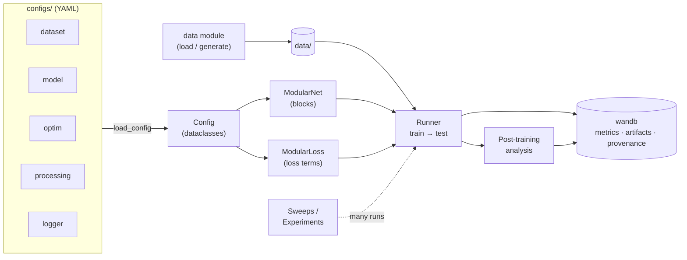

# modular_ml

[](https://github.com/imendezguerra/modular_ml/actions/workflows/ci.yml)
[](https://imendezguerra.github.io/modular_ml/)
[](LICENSE)

<!-- --8<-- [start:overview] -->
Tracking ML results is hard. Each result depends on the code, the data, the
preprocessing, the architecture, the loss and the optimiser settings, and these
quickly fall out of sync when a project compares many model variants.

modular_ml is a PyTorch template that keeps them linked:

- **Flexible, loggable architectures.** Networks and losses are assembled from
  blocks defined in [Hydra](https://hydra.cc) configs backed by Python dataclasses.
  A new architecture or objective is a YAML change, and the full resolved config
  is saved with every run.
- **Versioned data and results.** [Weights & Biases](https://wandb.ai) stores each
  run's metrics, checkpoints and test outputs as versioned artifacts, so any result
  can be traced back to its config and reloaded. Datasets can be versioned the same
  way as artifacts.
- **Provenance.** wandb records where and how each run was executed: git commit,
  command, host and environment. Multi-stage experiments also write a manifest
  linking each stage to its config and source checkpoint.

It is designed for projects that compare several architectures, losses and
optimisation strategies, including hyperparameter sweeps. Two example tasks
(a sequential RNN and a tabular MLP, both on synthetic data) run through the same
pipeline.
<!-- --8<-- [end:overview] -->

## How it fits together

<!-- --8<-- [start:diagram] -->


| Component | Code | What it does |
|---|---|---|
| **Data** | `data/` | Loads, converts or generates data into the pipeline format (`train.h5`, `test.h5`, `meta.yaml`); the examples generate synthetic data. |
| **Configs** | `configs/`, `configs/*_configs.py` | YAML files composed by Hydra into typed dataclasses: one group each for dataset, model, optimiser + losses, analysis and logging. |
| **ModularNet** | `models/` | Chains the blocks listed in the model config; each block reads and writes named tensors in a shared dict. |
| **ModularLoss** | `losses/` | Weighted, schedulable sum of loss terms listed in the optim config. |
| **Runner** | `pipeline/runner.py` | Trains and tests one config, saves checkpoints and test outputs, and logs everything. |
| **Post-training analysis** | `processing/` | Analyses the trained model and its test outputs (e.g. interpretability, representation analysis) and logs them to the same run. |
| **wandb** | `tools/logging.py` | Stores metrics, figures and versioned artifacts (config, checkpoints, outputs) with run provenance. |
| **Sweeps / Experiments** | `pipeline/pipeline.py` | Run many configs: hyperparameter sweeps, or multi-stage runs that reuse checkpoints. |
<!-- --8<-- [end:diagram] -->

<!-- --8<-- [start:concepts] -->
**Blocks are Python, architectures are YAML.** Each block (an RNN layer, a linear
readout, an encoder) is a Python class in `models/blocks.py`. Which blocks a model
uses, how they connect and their sizes are set in the model YAML, so a new
architecture needs no code, and a new kind of layer is one new block class. Losses
follow the same split: criteria are Python functions, and which terms apply, to
which tensors and with what weights is set in YAML.

**Analyses stay linked to their model.** Post-training analyses, such as
interpretability or representation analyses, run on the trained model and its test
outputs as the last step of each run, and log to the same wandb run. Every
analysis result is therefore tied to the exact model, config and data that
produced it. PCA and linear probes of hidden activity are the included examples.
<!-- --8<-- [end:concepts] -->

## Example tasks

<!-- --8<-- [start:tasks] -->
| Task | Data | Model | Loss | Metric |
|------|------|-------|------|--------|
| Sequential | frequency-cued sine waves `[T,B,F]` | `RNNBlock` → `LinearBlock` | MSE + scheduled smoothness | correlation |
| Tabular | gaussian-blob classes `[B,F]` | `FixedEncoderBlock` → `LinearBlock` | cross-entropy + weight L2 | accuracy |

Both run through the **same** `Runner`; only the configs differ.
<!-- --8<-- [end:tasks] -->

## Installation

<!-- --8<-- [start:install] -->
Requires Python 3.10+ and a [Weights & Biases](https://wandb.ai) account: every run
logs to wandb (the tests run with wandb disabled, so they need no account).

```bash
git clone https://github.com/imendezguerra/modular_ml.git && cd modular_ml

# Environment: conda (pins Python 3.11)...
conda env create -f environment.yaml && conda activate modular_ml
# ...or pip, in a virtualenv
pip install -e ".[dev,docs]"

pre-commit install   # git hooks: lint + format on commit, tests on push
wandb login
```

Runs log to the wandb project `modular_ml` by default. To change it:

```bash
export MODULAR_ML_PROJECT=my-project   # wandb project name
export WANDB_ENTITY=my-team            # wandb entity (team/user)
```
<!-- --8<-- [end:install] -->

## Quickstart

<!-- --8<-- [start:quickstart] -->
```bash
python scripts/generate_data.py                                  # synthetic data -> data/
python scripts/run_pipeline.py configs/runs/config_sequential.yaml  # train + test, RNN task
python scripts/run_pipeline.py configs/runs/config_tabular.yaml     # train + test, MLP task
python scripts/run_sweep.py                                      # hyperparameter sweep
python scripts/run_experiment.py                                 # two-stage experiment
pytest                                                           # tests, no wandb account needed
```
<!-- --8<-- [end:quickstart] -->

## Documentation

The [docs](https://imendezguerra.github.io/modular_ml/) cover the repository
structure, a step-by-step tutorial, each component in depth, how to extend the
template with your own data, blocks, losses and analyses, and the API reference.
To preview them locally, run `mkdocs serve` and open http://127.0.0.1:8000/modular_ml/.

## Contributing

See [`CONTRIBUTING.md`](CONTRIBUTING.md) for the development workflow, git hooks and CI.
Maintainers: the release process is in [`.github/RELEASING.md`](.github/RELEASING.md).

## Citation

If you use this code, please cite it with the **Cite this repository** button on GitHub,
which reads [`CITATION.cff`](CITATION.cff).

## License

[MIT](LICENSE)
