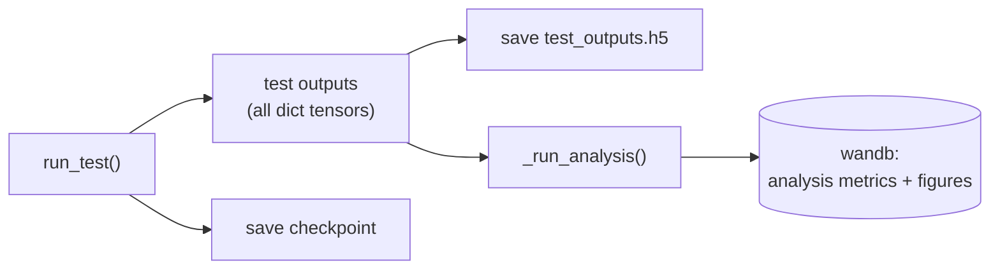

# Post-training analysis

The `processing/` module holds analyses that run **after a model is trained**,
on the model itself or on its test outputs: interpretability, representation or
dimensionality analysis, error breakdowns, and so on. They run as the last step
of `Runner.run_test()` and log to the same wandb run, so every analysis result is
linked to the model, config and data that produced it.

## Where it runs



The analysis receives the full output dict of the test pass: inputs, labels and
every block output (`rnn.activity`, `readout.prediction`, …), so it can analyse
any intermediate representation, not just the final prediction.

Two analyses are included, each switched on in the `processing` config group:
PCA (how many dimensions a representation uses) and linear probes (what
information it holds in a linearly readable form).

## PCA

`processing/dimensionality.py` runs PCA on each tensor listed in the
`processing` config group and logs:

- `pca/n_pcs.<key>`: number of PCs needed to reach `evr_threshold` explained variance.
- `pca/evr_top.<key>`: variance explained by the first PC.
- `pca/projections`: a figure of the first two PCs.

```yaml
# configs/runs/processing/analysis_rnn.yaml
_target_: modular_ml.configs.processing_configs.ProcessingConfig
run_pca: true
pca_keys: ["${model.hidden_key}"]
pca_dims: 10
evr_threshold: 0.95
```

## Linear probes

`processing/probing.py` fits a linear model from each representation in
`probe_keys` to each variable in `probe_targets`, and logs its cross-validated
score:

- `probe/r2.<key>-><target>`: R² of a ridge regression, for float targets.
- `probe/acc.<key>-><target>`: accuracy of a logistic regression, for integer
  targets (class labels).

A high score means the target is linearly decodable from the representation,
which is what a linear readout, or a downstream block, can use. Targets can be
any tensor in the outputs: inputs (`stim`), labels (`label.<key>`), or other
block outputs. Folds split by trial, so time steps from one sequence are never in
both the fitted and the scored set.

```yaml
# configs/runs/processing/analysis_rnn.yaml
run_probe: true
probe_keys: ["${model.hidden_key}"]
probe_targets: ["${dataset.in_key}"]   # decode the frequency / amplitude cues
probe_folds: 5
```

Probing the raw input with the same target (`probe_keys: [stim, ...]`) gives a
baseline: a score above it shows what the model computed, not just what it
received.

## Re-running an analysis later

Test outputs and checkpoints are logged as artifacts, so an analysis can also be
run after the fact on any past run:

```python
from modular_ml.processing.dimensionality import pca_analysis
from modular_ml.processing.probing import linear_probe
from modular_ml.processing.io import load_outputs_from_run

out = load_outputs_from_run("<run-id>")
metrics, projections = pca_analysis(out, ["rnn.activity"])
metrics = linear_probe(out, ["rnn.activity"], ["stim", "label.target"])
```

To add a new analysis to the pipeline, see
[Make it yours](make-it-yours.md#add-a-post-training-analysis).
