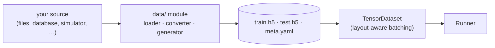
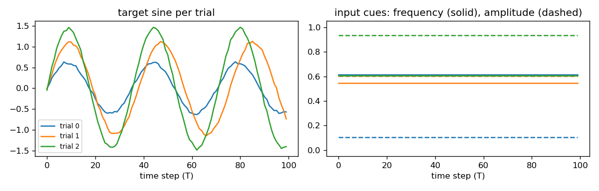
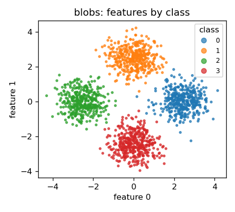

# Data

The `data/` module gets data into the format the pipeline reads, and batches
it during training. Every dataset, whatever its source, ends up as the same
on-disk format, so the rest of the pipeline never changes:



| File | Role |
|---|---|
| `data/data_gen.py` | Generators for the synthetic example datasets. Put your own loaders, converters or formatters alongside it. |
| `data/datasets.py` | Reads a split from disk and batches it (`load_split`, `TensorDataset`). Shared by every dataset. |

The examples use synthetic data so the pipeline runs out of the box, with no
external datasets.

## On-disk format

Each dataset directory contains:

- `train.h5`, `test.h5` — flat HDF5 of named arrays (via `tools/loaders.h5_save`).
- `meta.yaml` — dimensions, dt, tensor keys and the data **layout**.

`DatasetConfig.__post_init__` reads `meta.yaml`, so dimensions stay in sync
between the data and the config.

## Layouts

The data layout, set in `meta.yaml`, tells the dataset which axis holds samples:

| Layout | Shape | Axes | Batched along |
|---|---|---|---|
| `TBF` | `[T, B, F]` | **T**ime steps within a trial, **B**atch of trials, **F**eatures per time step | B (axis 1) |
| `BF` | `[B, F]` | **B**atch of samples, **F**eatures per sample | B (axis 0) |

`TBF` is time-major, the default layout of PyTorch recurrent layers.

## The example datasets

### Sequential (sine generation)

`generate_sine` produces a frequency/amplitude-cued sine task. A constant cue
per trial encodes the target wave; the model must emit the sine over time.

- Layout `TBF`: `[100 time steps, trials, features]`.
- Keys: `stim` (input), `target` (label). `in_dim=2`, `out_dim=1`.



### Tabular (gaussian blobs)

`generate_blobs` produces a nonlinear multi-class classification task — classes
on a ring, perturbed with gaussian noise.

- Layout `BF`: `[samples, features]`.
- Keys: `features` (input), `label` (int label). `out_dim = n_classes`.

{ width="360" }

## Batching

`data/datasets.py` wraps a split in a `TensorDataset` that is **layout-aware**:
it batches along the correct axis for either task and yields
`(data_dict, label_dict)` minibatches that drop straight into the model and
loss.

```python
from modular_ml.configs.dataset_configs import DatasetConfig
from modular_ml.data.datasets import load_split

ds = load_split(DatasetConfig(name="sine", data_dir="sine"), "train")
data, labels = next(ds.iter_batches(batch_size=32))
```

The label tensor goes only to `label_dict`, so a block can never read the target
by mistake (unless the label is also the input key, e.g. for an autoencoder).

## Validation split

The runner holds out `val_frac` of the train split (default `0.2`, seeded by the
run's `seed`) for validation. Validation metrics (`val/*`) are logged during
training and sweep objectives read them, so the test split is only used for the
final report. Set it in the dataset config:

```yaml
val_frac: 0.2   # 0 disables validation
```

## Generating the example data

```bash
python scripts/generate_data.py             # both datasets
python scripts/generate_data.py gen_sine    # just one (by config stem)
```

The generation parameters live in `configs/data_gen/*.yaml`.

## Bringing your own data

Write a loader or converter in `data/` that turns your raw data into a
`train.h5` / `test.h5` / `meta.yaml` triple (`tools/loaders.py` has `h5_save` and
`yaml_save`), then point a `dataset/*.yaml` config at the output directory. As long as the tensor keys match
your blocks' `in_keys` and the loss `label_key`, nothing else changes. See
[Make it yours](make-it-yours.md#use-your-own-data).
