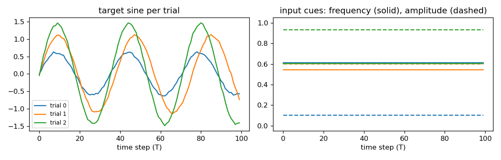
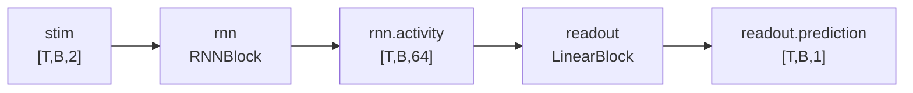
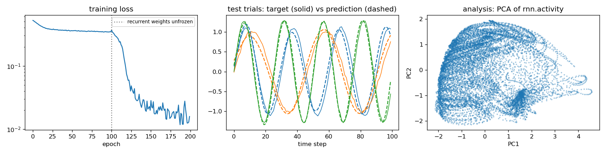
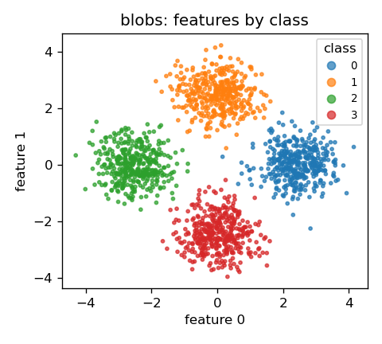
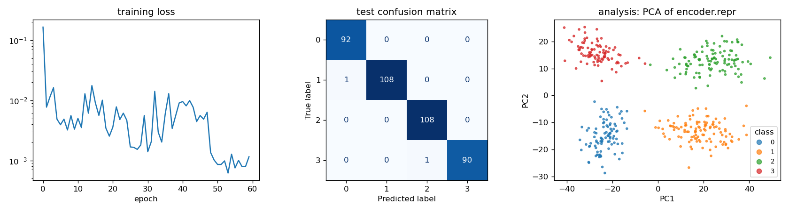

# Tutorial: end to end

This walkthrough builds up one run piece by piece: the data, the config, the
model, the loss, the analysis, and finally training and the logged results. It then
runs a second task through the same pipeline, a sweep and a two-stage experiment.
It uses only the configs that ship with the repo.

!!! tip "Prefer to run it interactively?"
    A runnable [**Google Colab notebook**](https://colab.research.google.com/github/imendezguerra/modular_ml/blob/main/notebooks/tutorial_colab.ipynb)
    (`notebooks/tutorial_colab.ipynb`) mirrors this page and executes end to end,
    with inline plots. It defaults to `WANDB_MODE=disabled` so it runs without a
    wandb account; flip one switch to log to a real project.

## 0. Setup

```bash
conda env create -f environment.yaml && conda activate modular_ml
wandb login
python scripts/generate_data.py
```

You now have `data/sine/` and `data/blobs/`.

## 1. The data: what the model has to learn

The sequential task is **cued sine generation**. Each trial gets two constant
input cues, a frequency cue and an amplitude cue (both scaled to [0, 1]), and the
model must output the matching sine wave `amp · sin(2π · freq · t)` over 100 time
steps.



Tensors use the `TBF` layout, `[T, B, F]`:

- **T**: time steps within a trial (100 steps of `dt = 0.01` s).
- **B**: trials, the axis that minibatches are drawn along.
- **F**: features per time step (2 input cues, 1 output value).

`python scripts/generate_data.py` writes `data/sine/train.h5`, `test.h5` and a
`meta.yaml` describing the dimensions and tensor keys (`stim` in, `target` out).
Generation parameters live in `configs/data_gen/gen_sine.yaml`. The run reads the
data through the **dataset** config group, which every other group interpolates
from:

```yaml title="configs/runs/dataset/seq_sine.yaml"
--8<-- "configs/runs/dataset/seq_sine.yaml"
```

When `data/sine/meta.yaml` exists, its dimensions, task type and keys override
these values, so config and data cannot disagree. See [Data](data.md) for the
format.

## 2. The run config: one file, five groups

A run is a single YAML that composes one file from each config group:

```yaml
# configs/runs/config_sequential.yaml
_target_: modular_ml.configs.main_configs.Config
defaults:
  - dataset: seq_sine      # which data, task type, tensor keys
  - model: model_rnn       # architecture: blocks and how they connect
  - optim: optim_mse       # optimiser + loss terms
  - logger: logger_reg     # wandb logging + sweep objective
  - processing: analysis_rnn    # post-training analysis
  - _self_
seed: 0
```

`load_config` composes these with Hydra, resolves interpolations such as
`${dataset.in_dim}`, and returns a typed `Config` dataclass. Swapping one line
(say `model: model_rnn` for another model file) changes that part only. See
[Configuration](configs.md).

## 3. The model: blocks wired by key

The model is a list of **blocks**. Each block reads tensors from a shared dict
by key and writes its outputs back as `<block id>.<out key>`. This model has two:



The full model config:

```yaml title="configs/runs/model/model_rnn.yaml"
--8<-- "configs/runs/model/model_rnn.yaml"
```

Each `${...}` is resolved when the config loads. `${dataset.…}` reads the dataset
group, `${model.…}` reads this file, and `${divide:a,b}` is a custom resolver
(see [Configuration](configs.md#interpolation-and-resolvers)):

| In the YAML | Comes from | Resolves to |
|---|---|---|
| `n_inputs: ${dataset.in_dim}` | dataset group (`meta.yaml`) | `2` |
| `n_outputs: ${dataset.out_dim}` | dataset group | `1` |
| `in_key: ${dataset.in_key}` | dataset group | `stim` |
| `dt_s: ${dataset.dt}` | dataset group | `0.01` |
| `alpha: ${divide:${model.dt_s},${model.tau_s}}` | `dt_s / tau_s` | `0.2` |
| `rnn.in_keys: ["${model.in_key}"]` | `model.in_key` | `[stim]` |
| `rnn.out_dim`, `readout.in_dim`: `${...global_params.hidden}` | `global_params` | `64` |
| `rnn.params.alpha: ${model.alpha}` | `model.alpha` | `0.2` |
| `init.linear_hh.weight.g: ${...global_params.g}` | `global_params` | `1.3` |

Keeping shared values in `global_params` means one edit (or one sweep parameter)
changes every block that uses them.

The block classes are Python (`models/blocks.py`); the YAML decides which ones
are used and how they connect. Two extra features appear here:

- **Per-parameter init**: the recurrent weights start from a scaled normal
  (`InitNormalRec`, gain `g`).
- **Runtime schedule**: the recurrent weights start **frozen** and are
  **unfrozen at epoch 100**, a simple curriculum.

See [Models and losses](models-and-losses.md).

## 4. The objective: a sum of loss terms

The loss is also a list of specs. Each term names a criterion, the dict keys it
reads, and a weight:

```yaml title="configs/runs/optim/optim_mse.yaml"
--8<-- "configs/runs/optim/optim_mse.yaml"
```

`label_key: ${dataset.label_key}` resolves to `target`, the tensor the
prediction is compared against. `in_keys` name tensors written by the model:
`readout.prediction` for the supervised term and, for the regulariser,
`${model.hidden_key}`, which the model config sets to `rnn.activity`. Other model
files set their own hidden key, so this file works with any of them.

Any tensor in the dict can be targeted, including hidden activity, and each
term's weight can follow a schedule (here the smoothness term ramps in over 100
epochs). Every term is logged separately.

## 5. The analysis: what to compute after training

```yaml title="configs/runs/processing/analysis_rnn.yaml"
--8<-- "configs/runs/processing/analysis_rnn.yaml"
```

After testing, the runner applies this analysis to the test outputs and logs the
results to the same run. The example measures the dimensionality of the RNN
activity (PCA) and how well the frequency and amplitude cues can be linearly
decoded from it (linear probe). See [Post-training analysis](analysis.md) to add your own.

## 6. Train, test and inspect the results

```bash
python scripts/run_pipeline.py configs/runs/config_sequential.yaml
```

The `Runner` builds the model, loss and optimiser from the config, trains, tests,
runs the analysis and logs everything to wandb:

| In wandb | What it is |
|---|---|
| `train/*`, `val/*`, `test/*` | total loss, each loss term, `corrcoef` |
| `runtime_schedule/stage_index` | marks the epoch where the schedule fired |
| `pca/n_pcs.rnn.activity`, `pca/projections` | PCA metric and figure |
| `probe/r2.rnn.activity->stim` | how well the cues can be linearly decoded from the hidden activity |
| `config`, `model`, `outputs` artifacts | resolved config, checkpoint, all test tensors |



The loss plateaus while the recurrent weights are frozen and drops once they are
unfrozen at epoch 100. Test predictions follow the target sines, and the PCA of
the hidden activity shows the low-dimensional dynamics the network learned.

## 7. Same pipeline, different task

```bash
python scripts/run_pipeline.py configs/runs/config_tabular.yaml
```

The tabular task classifies 2-D points into 4 classes arranged on a ring (`BF`
layout: `[samples, features]`).

{ width="360" }

Only the configs differ: a `FixedEncoderBlock → LinearBlock` model, a
`cross_entropy` term plus an L2 penalty on the readout weights
(`requires_model: true`), accuracy as the metric, and PCA plus a label probe on the
encoder output. The `Runner`, data layer and loss machinery are unchanged.

??? example "Full tabular configs"

    ```yaml title="configs/runs/config_tabular.yaml"
    --8<-- "configs/runs/config_tabular.yaml"
    ```

    ```yaml title="configs/runs/model/model_mlp.yaml"
    --8<-- "configs/runs/model/model_mlp.yaml"
    ```

    ```yaml title="configs/runs/optim/optim_ce.yaml"
    --8<-- "configs/runs/optim/optim_ce.yaml"
    ```

    Here `n_inputs` and `n_outputs` resolve to `2` and `4` (features and classes
    from `meta.yaml`), `in_key` to `features` and `label_key` to `label`. The
    `weights` term has `requires_model: true`, so `in_keys: [readout]` names a
    block whose parameters are penalised, not a tensor.



Training loss, the test confusion matrix (predicted vs true class), and the PCA of
the encoder output: the four classes form separate clusters, which is what lets the
linear readout classify them.

## 8. Load a run's outputs in Python

```python
from modular_ml.processing.io import load_outputs_from_run

out = load_outputs_from_run("<your-run-id>")  # last part of the run URL
print(out.keys())  # rnn.activity, readout.prediction, label.target, ...
print(out["rnn.activity"].shape)  # (100, 102, 64) = [T, test trials, hidden]
```

Files are read from `outputs/<run>/` if present, otherwise downloaded from the
wandb artifact.

## 9. Run a sweep

```bash
python scripts/run_sweep.py
```

This sweeps the learning rate and recurrent gain `g` over the sequential config
(`configs/sweeps/sweep_rnn.yaml`), maximising `sweep/objective`
(= `val/corrcoef`, on data held out from the train split). Compare the runs in the wandb sweep view. See
[Sweeps](sweeps.md).

## 10. Run a two-stage experiment

```bash
python scripts/run_experiment.py
```

Stage 1 (`pretrain`) trains from scratch; stage 2 (`finetune`) starts from stage
1's checkpoint (`load_params_from: pretrain`). A manifest linking each stage to
its config and wandb run is logged as an `experiment` artifact of each stage's
run (the last stage holds the complete one). See
[Experiments](experiment-usage.md).

## Next

You have seen every element of a run. [Tracking & reproducibility](tracking-and-reproducibility.md)
shows what each run records and how to trace any result back to its config,
code and checkpoint.
